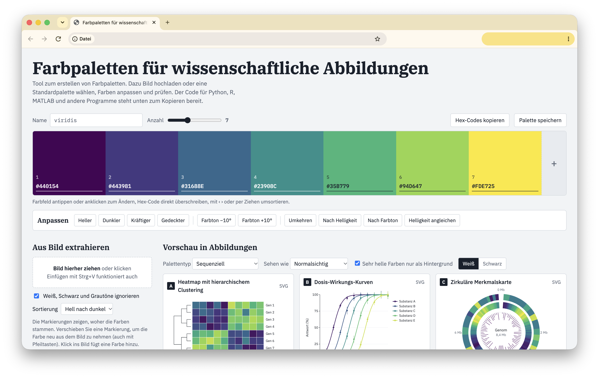

# Farbpaletten für wissenschaftliche Abbildungen

Ein Werkzeug zum Erstellen, Prüfen und Exportieren von Farbpaletten für wissenschaftliche Diagramme 
– als **eine einzige HTML-Datei**, ohne Installation, ohne Build-Schritt und ohne Server.



**[➜ Direkt im Browser öffnen](https://chrisspatschek-sudo.github.io/farbpaletten-generator)**

## Funktionen

- **Bibliothek mit über 80 Paletten** – sequenziell, divergierend und qualitativ, u. a. viridis, cividis, Okabe-Ito, Paul Tol, ColorBrewer, Scientific Colour Maps (Crameri), cmocean, seaborn sowie Paletten von Fachzeitschriften und Medien (Nature, Science, Lancet, NEJM, The Economist …)
- **Farben aus Bildern extrahieren** – Bild per Drag & Drop laden, Farben automatisch bestimmen und Markierungen im Bild verschieben
- **Anpassen** – heller/dunkler, kräftiger/gedeckter, Farbton drehen, umkehren, nach Helligkeit oder Farbton sortieren, Helligkeit gleichmäßig verteilen
- **Vorschau in realistischen Abbildungen** – u. a. gruppierte Balken mit Fehlerbalken, Dosis-Wirkungs-Kurven, Heatmap mit Clustering, UMAP-Clustering, Violinplots, Spektren, polare Darstellungen; auf weißem oder schwarzem Hintergrund
- **Barrierefreiheit prüfen** – Simulation von Deuteranopie, Protanopie, Tritanopie und Graustufendruck
- **Unterscheidbarkeit messen** – kleinster Farbabstand (ΔE in OKLab), Helligkeitsverlauf und Rollenvorschläge
- **Export** – fertiger Code für Python (matplotlib/seaborn), R/ggplot2, MATLAB, LaTeX, CSS, JSON, RGB/Office und als Hex-Liste; außerdem GIMP/Inkscape-Palette (`.gpl`) und SVG
- **Eigene Paletten speichern** – lokal im Browser

## Verwendung

**Online:** Über den Link oben (GitHub Pages).

**Offline:** `index.html` herunterladen und per Doppelklick im Browser öffnen. Es wird nichts installiert.

Unterstützt werden aktuelle Versionen von Firefox, Chrome, Edge und Safari.

## Datenschutz

- Bilder werden ausschließlich **lokal im Browser** verarbeitet und nicht hochgeladen.
- Gespeicherte Paletten liegen im `localStorage` des Browsers (Schlüssel `sci-pal-saved`) und verlassen das Gerät nicht.
- Die Schriftarten (IBM Plex) werden von **Google Fonts** geladen. Dabei wird die IP-Adresse an Google übertragen. Ohne Internetverbindung funktioniert das Werkzeug trotzdem, dann mit Systemschriften.

## Projektstruktur

```
.
├── index.html      # die komplette Anwendung (HTML, CSS, JavaScript)
├── README.md
├── CHANGELOG.md
├── LICENSE
└── .gitignore
```

## Quellen der Paletten

Die Farbwerte stammen aus den jeweiligen Originalquellen; deren Urheberinnen und Urhebern gilt der Dank:

- **viridis, magma, inferno, plasma** – van der Walt & Smith (matplotlib); **cividis** – Nuñez, Anderton & Renslow (2018)
- **Okabe-Ito** – Okabe & Ito (2008), empfohlen von Wong (2011), *Nature Methods*
- **Paul Tol** – Paul Tol, SRON: *Colour Schemes*
- **ColorBrewer** – Cynthia Brewer, Penn State University
- **Scientific Colour Maps** (batlow, vik, roma …) – Fabio Crameri
- **cmocean** (thermal, haline, balance …) – Kristen Thyng et al.
- **seaborn** – Michael Waskom
- **turbo** – Google AI
- Paletten von Fachzeitschriften und Medien nach den Zusammenstellungen in *ggsci* (Nan Xiao) bzw. *ggthemes* sowie den jeweiligen Styleguides
- Farbabstände in **OKLab** – Björn Ottosson, <https://bottosson.github.io/posts/oklab/>

Die Namen von Zeitschriften, Verlagen und Medien dienen nur der Beschreibung; es besteht keine Verbindung zu ihnen.

## Mitwirken

Fehler und Vorschläge gerne als [Issue](../../issues). Pull Requests sind willkommen – da alles in `index.html` steckt, genügt ein Texteditor.

## Lizenz

[MIT](LICENSE) © 2026 Chris Spatschek
